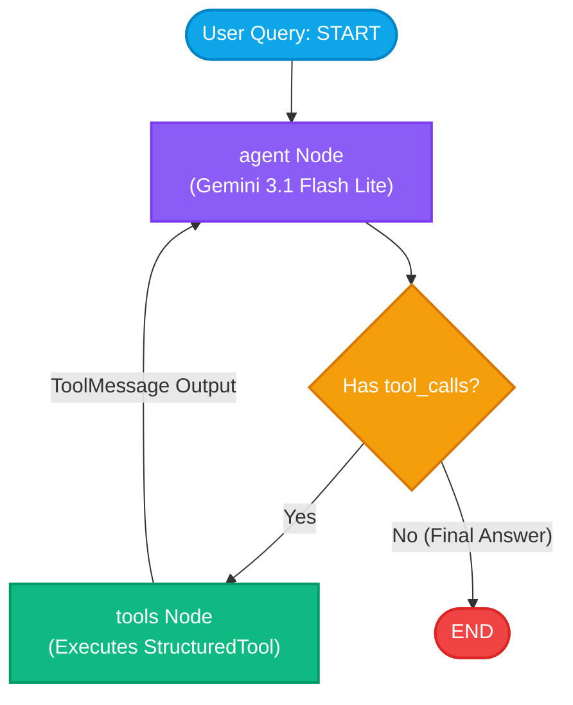

# LangGraph Tool Calling & Orchestrator Workflow

An interactive **Multi-Agent / Tool-Calling Orchestrator** built using **LangGraph**, **LangChain**, and **Google Gemini**. 

This project demonstrates how to dynamically convert standalone Python modules and JSON specifications into **LangChain Structured Tools**, register them with a language model, and execute cyclical agent workflows using a compiled **LangGraph state machine**. It also includes a visual web-based flow animator for real-time inspection of state transitions, tool payloads, and node executions.

---

## 📌 Table of Contents
1. [Core Architecture Overview](#-core-architecture-overview)
2. [What is a Structured Tool?](#-what-is-a-structured-tool)
3. [Building Structured Tools from Directories](#-building-structured-tools-from-directories)
   - [Tool Directory Convention](#1-tool-directory-convention)
   - [Dynamic Pydantic Schema Generation (`loader.py`)](#2-dynamic-pydantic-schema-generation-loaderpy)
   - [Step-by-Step Example: Adding a New Tool](#3-step-by-step-example-adding-a-new-tool)
4. [Building the LangGraph Orchestrator Workflow](#-building-the-langgraph-orchestrator-workflow)
   - [State Definition (`AgentState`)](#1-state-definition-agentstate)
   - [The Agent Node](#2-the-agent-node)
   - [The Tools Node](#3-the-tools-node)
   - [Conditional Routing (`should_continue`)](#4-conditional-routing-should_continue)
   - [Compiling the State Graph](#5-compiling-the-state-graph)
5. [Workflow Architecture Diagram](#-workflow-architecture-diagram)
6. [Interactive Web Visualizer](#-interactive-web-visualizer)
7. [Repository Structure](#-repository-structure)
8. [Getting Started Locally](#-getting-started-locally)
9. [Deployment (Vercel & Cloud)](#-deployment-vercel--cloud)

---

## 🚀 Core Architecture Overview

Modern Large Language Models (LLMs) cannot execute Python code directly. Instead, they operate via **Tool Calling (Function Calling)**:
1. The orchestrator describes available tools to the LLM using standard JSON schemas.
2. When the user asks a question, the LLM determines whether a tool is required and returns a structured **Tool Call Request** (`tool_name`, `args`).
3. LangGraph intercepts this request, routes execution to a designated **Tool Node**, runs the local Python function, and encapsulates the output in a **`ToolMessage`**.
4. The result is fed back into the LLM so it can formulate the final answer (or trigger another tool call in a multi-step chain).

---

## 🧩 What is a Structured Tool?

In LangChain, a **`StructuredTool`** is a wrapper around an arbitrary Python function that gives it:
- **A Unique Name:** Identifies the tool to the LLM (e.g., `multiply`, `calculate_sales_tax`).
- **A Natural Language Description:** Explains what the tool does, when to call it, and what it returns.
- **A Pydantic Validation Schema (`args_schema`):** A strictly typed model defining input parameters, types (`int`, `float`, `str`, `bool`), default values, and parameter descriptions.

### Why not use raw Python functions?
LLMs require explicit JSON Schema definitions (type declarations, required arguments, docstrings) to generate valid function call payloads. `StructuredTool` bridges Python functions with the Gemini/OpenAI Tool-Calling API, guaranteeing that arguments passed by the model conform to valid types before invoking your code.

```python
from langchain_core.tools import StructuredTool
from pydantic import BaseModel, Field

class MultiplyInput(BaseModel):
    a: float = Field(..., description="First factor")
    b: float = Field(..., description="Second factor")

def multiply(a: float, b: float) -> dict:
    return {"result": a * b}

# Manually declaring a StructuredTool:
my_tool = StructuredTool(
    name="multiply",
    description="Multiplies two numbers together",
    func=multiply,
    args_schema=MultiplyInput
)
```

---

## 🛠️ Building Structured Tools from Directories

Rather than hardcoding tools in Python files, this project uses a **modular tool registry pattern**. Any folder placed inside `registry/tools/` is automatically discovered and converted into a `StructuredTool` at runtime.

### 1. Tool Directory Convention

Each tool lives in its own self-contained folder:
```
registry/tools/
├── calculate_percentage_discount/
│   ├── tool.json       <-- Specification & schema manifest
│   └── tool.py         <-- Execution logic
├── calculate_sales_tax/
│   ├── tool.json
│   └── tool.py
└── multiply/
    ├── tool.json
    └── tool.py
```

#### `tool.json` (Specification Manifest)
Defines tool metadata and argument contracts:
```json
{
  "name": "multiply",
  "description": "Multiplies two numbers together.",
  "parameters": {
    "type": "object",
    "properties": {
      "a": { "type": "number", "description": "The first number." },
      "b": { "type": "number", "description": "The second number." }
    },
    "required": ["a", "b"]
  },
  "returns": {
    "type": "object",
    "properties": {
      "result": { "type": "number", "description": "The multiplication result." }
    }
  }
}
```

#### `tool.py` (Execution Function)
Contains a standard `run(**kwargs)` function:
```python
def run(a: float, b: float) -> dict:
    return {
        "operation": "multiplication",
        "a": a,
        "b": b,
        "result": a * b
    }
```

---

### 2. Dynamic Pydantic Schema Generation (`loader.py`)

The dynamic loader ([`loader.py`](file:///e:/IIT%20M%20Asssignment/Multi-Agent-System/Tool_calling_demo/loader.py)) performs 5 steps to convert this folder into a `StructuredTool`:

```python
def load_tool_from_directory(tool_dir: Path) -> StructuredTool:
    # 1. Read JSON manifest
    with open(tool_dir / "tool.json", "r", encoding="utf-8") as f:
        meta = json.load(f)

    # 2. Dynamically import run() function from tool.py
    spec = importlib.util.spec_from_file_location(meta["name"], tool_dir / "tool.py")
    module = importlib.util.module_from_spec(spec)
    spec.loader.exec_module(module)
    func = getattr(module, "run")

    # 3. Dynamically construct a Pydantic schema using create_model
    fields = {}
    for prop_name, prop_data in meta.get("parameters", {}).get("properties", {}).items():
        py_type = TYPE_MAPPING.get(prop_data.get("type"), str)
        desc = prop_data.get("description", "")
        default_val = ... if prop_name in meta["parameters"].get("required", []) else None
        fields[prop_name] = (py_type, Field(default=default_val, description=desc))

    args_schema = create_model(f"{meta['name']}_args", **fields)

    # 4. Enhance description with return format documentation
    full_description = f"{meta['description']} Returns JSON with keys: ..."

    # 5. Instantiate and return StructuredTool
    return StructuredTool(
        name=meta["name"],
        description=full_description,
        func=func,
        args_schema=args_schema
    )
```

The `discover_registry_tools()` function iterates over all folders in `registry/tools/` and compiles an executable list of `StructuredTool` instances.

---

### 3. Step-by-Step Example: Adding a New Tool

To add an **Addition (`add`)** tool:

1. Create folder: `registry/tools/add/`
2. Create `registry/tools/add/tool.json`:
   ```json
   {
     "name": "add",
     "description": "Calculates the sum of two numbers (a + b). Use whenever addition is required.",
     "parameters": {
       "type": "object",
       "properties": {
         "a": { "type": "number", "description": "First number" },
         "b": { "type": "number", "description": "Second number" }
       },
       "required": ["a", "b"]
     },
     "returns": {
       "type": "object",
       "properties": {
         "result": { "type": "number", "description": "The sum" }
       }
     }
   }
   ```
3. Create `registry/tools/add/tool.py`:
   ```python
   def run(a: float, b: float) -> dict:
       return {"operation": "addition", "a": a, "b": b, "result": a + b}
   ```
4. **Done!** The loader automatically detects the new directory. No orchestrator changes required.

---

## 🔄 Building the LangGraph Orchestrator Workflow

The agent logic is orchestrated by a state graph in [`orchestrator.py`](file:///e:/IIT%20M%20Asssignment/Multi-Agent-System/Tool_calling_demo/orchestrator.py).

### 1. State Definition (`AgentState`)
LangGraph coordinates workflow nodes through a shared state dictionary. We use `add_messages` to append new messages rather than overwrite existing ones:

```python
from typing import Annotated
from typing_extensions import TypedDict
from langchain_core.messages import BaseMessage
from langgraph.graph.message import add_messages

class AgentState(TypedDict):
    messages: Annotated[list[BaseMessage], add_messages]
```

### 2. The Agent Node
Invokes the Google Gemini model with the bound tool schemas:

```python
llm = ChatGoogleGenerativeAI(model="gemini-3.1-flash-lite", temperature=0)
llm_with_tools = llm.bind_tools(tools)

def agent_node(state: AgentState):
    response = llm_with_tools.invoke(state["messages"])
    return {"messages": [response]}
```

### 3. The Tools Node
Extracts tool calls requested by the model, executes each tool from `tool_map`, and appends the outputs as `ToolMessage` entries:

```python
def tool_node(state: AgentState):
    last_message = state["messages"][-1]
    tool_messages = []

    for call in getattr(last_message, "tool_calls", []):
        name = call["name"]
        args = call["args"]
        tool = tool_map.get(name)

        output = tool.invoke(args) if tool else {"error": f"Tool '{name}' not found."}

        tool_messages.append(
            ToolMessage(
                content=json.dumps(output),
                name=name,
                tool_call_id=call["id"]
            )
        )

    return {"messages": tool_messages}
```

### 4. Conditional Routing (`should_continue`)
Determines the next edge after the model speaks:
- If the model returned `tool_calls` $\rightarrow$ route to `"tools"`.
- If the model returned plain text (final response) $\rightarrow$ route to `END`.

```python
def should_continue(state: AgentState) -> Literal["tools", "__end__"]:
    last_msg = state["messages"][-1]
    if hasattr(last_msg, "tool_calls") and last_msg.tool_calls:
        return "tools"
    return END
```

### 5. Compiling the State Graph
Assemble the graph nodes and edges:

```python
workflow = StateGraph(AgentState)

# Add Nodes
workflow.add_node("agent", agent_node)
workflow.add_node("tools", tool_node)

# Add Edges
workflow.add_edge(START, "agent")
workflow.add_conditional_edges("agent", should_continue, ["tools", END])
workflow.add_edge("tools", "agent")  # Loop back to agent with tool results

app = workflow.compile()
```

---

## 📊 Workflow Architecture Diagram



### Example Multi-Step Query Execution
**Query:** *"I bought 3 mechanical keyboards at $50 each with a 10% discount and 8% sales tax. What is my final total?"*
1. **START $\rightarrow$ `agent`:** Model calls `multiply(a=3, b=50)` $\rightarrow$ Output: `150.0`.
2. **`tools` $\rightarrow$ `agent`:** Model calls `calculate_percentage_discount(original_price=150, discount_percentage=10)` $\rightarrow$ Output: `135.0`.
3. **`tools` $\rightarrow$ `agent`:** Model calls `calculate_sales_tax(amount=135, tax_rate=8)` $\rightarrow$ Output: `145.8`.
4. **`tools` $\rightarrow$ `agent`:** Model determines no more tools are needed and outputs the final formatted checkout answer.
5. **`agent` $\rightarrow$ `END`:** Execution terminates.

---

## 💻 Interactive Web Visualizer

The project includes an interactive web application located in the [`APP/`](file:///e:/IIT%20M%20Asssignment/Multi-Agent-System/Tool_calling_demo/APP) directory:

- **State Inspector:** View full LangGraph `messages` payload at every step.
- **Node Highlighting:** Follow animated state transitions (`START` $\rightarrow$ `agent` $\rightarrow$ `tools` $\rightarrow$ `agent` $\rightarrow$ `END`).
- **Interactive Step Playback:** Forward, rewind, auto-play, and step-by-step slider.
- **Persistent Rate-Limit Banner:** Handles Gemini API quota and HTTP 429 rate limits gracefully.
- **No Build Tools Required:** Pure vanilla JavaScript, CSS variables, and native browser Fetch API.

---

## 📁 Repository Structure

```
├── APP/                                # Standalone Web Application
│   ├── app.js                          # Client-side state & timeline renderer
│   ├── index.html                      # Flow visualizer UI
│   ├── style.css                       # Modern dark theme styles
│   ├── server.py                       # Python HTTP server & Vercel serverless entrypoint
│   ├── runner.py                       # LangGraph execution tracer & state streamer
│   ├── orchestrator.py                 # Workflow builder for APP
│   ├── loader.py                       # Tool loader for APP
│   ├── requirements.txt                # Production dependencies for Vercel
│   ├── vercel.json                     # Vercel serverless routing configuration
│   └── registry/tools/                 # Tools bundled for web app
├── registry/tools/                     # Root tool definitions
│   ├── calculate_percentage_discount/
│   │   ├── tool.json
│   │   └── tool.py
│   ├── calculate_sales_tax/
│   │   ├── tool.json
│   │   └── tool.py
│   └── multiply/
│       ├── tool.json
│       └── tool.py
├── loader.py                           # Dynamic tool loader
├── orchestrator.py                     # LangGraph state machine definition
├── run.py                              # CLI runner demo
├── requirements.txt                    # Project pip requirements
└── README.md                           # Documentation
```

---

## ⚡ Getting Started Locally

### 1. Clone & Set Up Virtual Environment
```bash
git clone https://github.com/kushaljgec2025/LangGraph-Tool-Calling-Demo.git
cd LangGraph-Tool-Calling-Demo

python -m venv venv
# On Windows:
venv\Scripts\activate
# On Linux/macOS:
source venv/bin/activate

pip install -r requirements.txt
```

### 2. Configure Environment Variables
Create a `.env` file in the root directory and in `APP/.env`:
```env
GEMINI_API_KEY="your-google-gemini-api-key"
```

### 3. Run the CLI Demo
```bash
python run.py
```

### 4. Launch the Web Visualizer
```bash
cd APP
python server.py
```
Open **`http://localhost:8000`** in your browser to run queries and inspect the interactive graph execution.

---
